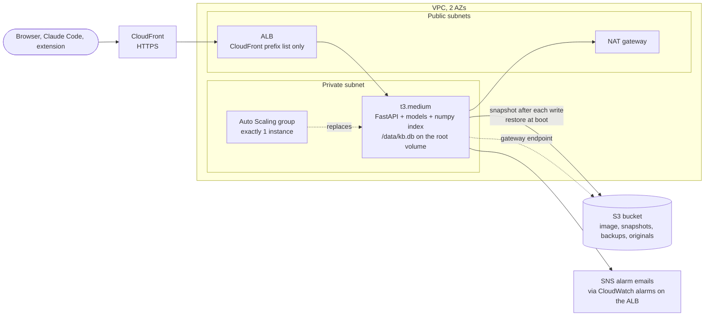
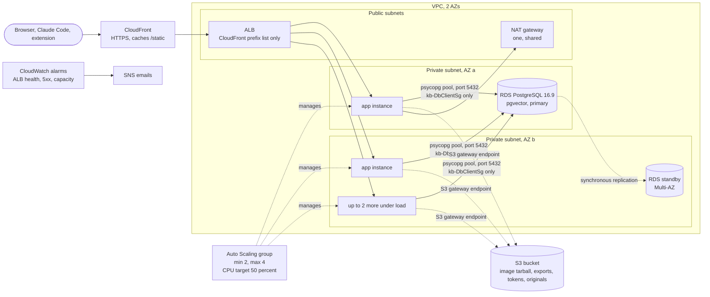

# kb-mcp

A self-hosted knowledge base that Claude can search and write to through MCP, built as a prototype for the Cloud Computing course (AWS Academy Cloud Architecting). One FastAPI service runs on AWS behind CloudFront and an ALB. It does semantic search with small CPU models (a bge embedder and a cross-encoder reranker, no GPU, no external API), falls back to keyword search when the models fail or the instance is busy, and says how confident an answer is so an assistant can tell the user when the knowledge base has nothing.

What the demo shows (`docs/DEMO.md`): searching the web UI and Claude Code over MCP, adding a note and a whole PDF, near-duplicate detection and merge, stale and gaps reports, the keyword fallback, a failover with nothing lost, and the architecture that carries it.

- **12 MCP tools** for searching, adding, editing and uploading documents, over HTTP (`/mcp`) or stdio.
- **Over HTTP the five read tools need no token; the seven write tools need a write token** (phase 24 decision, see Known limitations). The REST API, web UI and Chrome extension need a write token for writes too.
- **One command deploys everything:** `infra/up.sh` builds the image and deploys the four stacks (`kb-network`, `kb-data`, `kb-db`, `kb-app`). `infra/up.sh save` backs up the database before the sandbox session ends.
- **Students:** `docs/STUDENTS.md`. **Instructor runbook:** `docs/DEMO.md`. **Decisions and measurements:** `docs/PROGRESS.md`. **Security:** `docs/SECURITY_REVIEW.md`. **Setup detail for Linux and Windows:** `docs/SETUP.md`.

---

## Architecture

The sandbox shaped the design: ECR and EFS are denied (`AccessDenied`), so the image travels through S3 as a tarball; IAM is read only and the instance role is `myS3Role` (S3 only), so there are no custom roles, no CloudWatch Logs and no custom metrics from the instances.

### Phase 1: one instance, SQLite on the root volume

The database is one SQLite file on the instance root volume. After every write it is snapshotted to S3 (at most one upload per 5 seconds), and a replacement instance restores the latest snapshot at boot.



### Phase 2: stateless instances, RDS PostgreSQL with pgvector

Any instance answers any request: documents, vectors, upload tickets and the keyword-fallback toggle live in RDS. Cosine search runs in the database (pgvector); keyword search uses `tsvector`. The group runs 2 to 4 instances (CPU target tracking at 50 percent, never above 4) in two AZs. RDS is Multi-AZ (single-AZ costs half, see cost notes). The S3 export (`snapshots/kb-latest.db.gz`, a SQLite file) is the portable backup.



Boot of an instance in `postgres` mode: install Docker, `docker load` the image from S3, import the S3 export into RDS only if the database is empty (`import-sqlite --if-empty`), start the container, load the models (about 3 minutes from launch to a healthy target on an idle stack, up to about 10 under load). Nightly at 07:15 UTC every instance runs `export-sqlite --once-per 3600`, and the first to claim the run in the database exports while the others skip; `infra/up.sh save` asks the app for a fresh export and downloads it.

### The four stacks

| Stack | Holds | Delete it? |
| --- | --- | --- |
| `kb-network` | VPC, 2 public and 2 private subnets, internet gateway, route tables, S3 gateway endpoint | Never without asking |
| `kb-data` | The versioned, encrypted, private S3 bucket: image tarballs, database snapshots and exports, backups, originals, write tokens (`config/write-tokens`), the RDS URL (`config/database-url`) | Never without asking |
| `kb-db` | RDS PostgreSQL 16.9 `db.t3.micro`, Multi-AZ, 20 GB gp2, encrypted, private, subnet group, security groups | Only after an export to S3 (deleting it destroys the data) |
| `kb-app` | NAT gateway, ALB, CloudFront, launch template, Auto Scaling group and scaling policy, alarms, SNS topic, dashboard | Between sessions to save credit (the next deploy restores the data) |

`DatabaseMode=sqlite` (the default) runs phase 1 (exactly 1 instance, no `kb-db`); `DatabaseMode=postgres` runs phase 2.

---

## Setup

Run everything in a bash shell: Linux, or the Ubuntu terminal (WSL2) on Windows. Steps 1 to 6 are done once per computer. Step 7 is partly once per computer and partly once per lab session.

### 1. Windows only: install WSL2 and Docker Desktop

In PowerShell as administrator:

```powershell
wsl --install -d Ubuntu
```

Reboot, open **Ubuntu** from the Start menu and create your Linux user.

For Docker, either install [Docker Desktop](https://www.docker.com/products/docker-desktop/) and turn on *Settings > Resources > WSL integration > Ubuntu* (Docker Desktop must be running whenever you deploy), or install Docker inside Ubuntu with the Linux steps in step 3.

Do all the remaining steps in the Ubuntu terminal, and keep the repo in your Linux home (`~/kb-mcp`), **not** under `/mnt/c/...`. On the Windows drive the scripts lose their executable bit and builds are slow.

### 2. Base tools

Ubuntu or Debian (including WSL):

```bash
sudo apt update
sudo apt install -y git curl unzip jq python3 python3-venv python3-pip
python3 --version   # must be 3.12 or newer
```

Fedora:

```bash
sudo dnf install -y git curl unzip jq python3 python3-pip
python3 --version   # must be 3.12 or newer
```

### 3. Docker (skip on Windows if you use Docker Desktop)

Ubuntu or Debian:

```bash
sudo apt install -y docker.io docker-buildx
sudo usermod -aG docker "$USER"
```

Fedora:

```bash
sudo dnf -y install dnf-plugins-core
sudo dnf config-manager addrepo --from-repofile=https://download.docker.com/linux/fedora/docker-ce.repo
sudo dnf install -y docker-ce docker-ce-cli containerd.io docker-buildx-plugin
sudo systemctl enable --now docker
sudo usermod -aG docker "$USER"
```

The new `docker` group only applies to a fresh login. On Linux, log out and back in. In WSL, logging out is not enough: run `wsl --shutdown` in PowerShell, then reopen Ubuntu. Then check:

```bash
groups                    # must list "docker"
docker run hello-world
```

Without this, `infra/up.sh` stops at the image build with `permission denied while trying to connect to the docker API at unix:///var/run/docker.sock`.

### 4. AWS CLI v2

```bash
cd ~
curl -s "https://awscli.amazonaws.com/awscli-exe-linux-x86_64.zip" -o awscliv2.zip
sudo unzip -q awscliv2.zip
sudo ./aws/install
sudo rm -rf aws awscliv2.zip
aws --version
```

### 5. Get the code

Set up an SSH key for this computer first (press Enter at every prompt), and add the printed line on GitHub under *Settings > SSH and GPG keys > New SSH key*:

```bash
ssh-keygen -t ed25519 -C "$(hostname)"
cat ~/.ssh/id_ed25519.pub
ssh -T git@github.com            # should say "Hi ethan-n-johnson!"
```

Then clone (no `sudo`, so the files belong to you):

```bash
git config --global core.autocrlf input   # keeps Windows line endings out of the scripts
git clone git@github.com:ethan-n-johnson/kb-mcp.git ~/kb-mcp
cd ~/kb-mcp
```

If a script ever fails with `Permission denied`, the executable bit was lost: `chmod +x infra/*.sh infra/scripts/*.sh`.

### 6. Python environment and tests

```bash
cd ~/kb-mcp
python3 -m venv .venv
.venv/bin/pip install -e '.[dev]'    # also installs cfn-lint, which deploy.sh needs
.venv/bin/python -m pytest -q        # fast tests, should all pass
```

The deploy scripts call `.venv/bin/cfn-lint` directly, so the venv does not need to be active for `infra/up.sh`. Activate it (`source .venv/bin/activate`) when you want to run `pytest` or other Python tools by name.

### 7. Config files

All config lives outside the repo, in `~/.aws` and `~/.config/kb-mcp`.

**Windows (WSL) only: check that `~/.aws` is a real Linux folder.** It can be a link to `C:\Users\<you>\.aws` on the Windows drive. Files there do not support Linux permissions (`chmod: Operation not permitted`), and writing to it overwrites the Windows AWS settings. Check, and replace the link with a real folder:

```bash
ls -ld ~/.aws               # bad if it shows "-> /mnt/c/..."
rm ~/.aws                   # only if it is a link; removes the link, not the Windows folder
```

**Create the files once per computer** (this makes empty ones with the right permissions):

```bash
mkdir -p -m 700 ~/.aws ~/.config/kb-mcp
printf '[default]\nregion = us-east-1\noutput = json\n' > ~/.aws/config
touch ~/.aws/credentials ~/.config/kb-mcp/up.env
chmod 600 ~/.aws/config ~/.aws/credentials ~/.config/kb-mcp/up.env
```

**Fill in `up.env`** (once per computer) with `nano ~/.config/kb-mcp/up.env`. Use your own email; do not leave the example address:

```ini
# Required: where the CloudWatch alarm emails go (confirm the SNS email once per new account)
KB_ALERT_EMAIL=you@example.com
# The only instance profile the sandbox lets EC2 use (this is also the default)
KB_INSTANCE_PROFILE=myS3Role
# Phase 2 (RDS PostgreSQL, 2 to 4 app instances): use postgres. The default is sqlite (one instance)
KB_DATABASE_MODE=postgres
# Optional, see infra/deploy.sh (KB_METRICS_MODE defaults to off, KB_SEARCH_RATE to 120/minute)
# KB_METRICS_MODE=
# KB_EXTENSION_ORIGIN=
```

**Fill in the credentials** (every lab session). Start the lab in AWS Academy, open **AWS Details > AWS CLI: Show**, and copy the whole `[default]` block. Then open the file, delete what is there, and paste it:

```bash
nano ~/.aws/credentials
```

It should look like this, with real values (the session token is very long):

```ini
[default]
aws_access_key_id=ASIA...
aws_secret_access_key=...
aws_session_token=...
```

In nano, right-click pastes in most terminals; Ctrl+O then Enter saves, Ctrl+X exits. Check it:

```bash
aws sts get-caller-identity       # prints the sandbox account ID
```

`InvalidClientTokenId` means the file still has placeholder or old values; `ExpiredToken` means the lab session ran out. In both cases paste a fresh block from AWS Details.

**Move your knowledge base over** (new computer or new sandbox account). `infra/up.sh` restores the database from the bucket, or from `~/.config/kb-mcp/kb-latest.db.gz` when the bucket has none. Without either, the app starts empty (`up.sh` says `no database snapshot in the bucket or saved locally`). So before the first deploy on a new computer, copy `kb-latest.db.gz` from the last computer that ran `infra/up.sh save`:

```bash
cp /path/to/kb-latest.db.gz ~/.config/kb-mcp/
```

In WSL, Windows folders are under `/mnt/c/Users/<you>/`, for example `/mnt/c/Users/<you>/Downloads/kb-latest.db.gz`.

`~/.config/kb-mcp/write-tokens` (used by the REST API, web UI, extension and the MCP write tools) is created by `infra/up.sh` on its first run.

---

---

## Deploy, save and tear down

```bash
cd ~/kb-mcp
infra/up.sh                  # deploys what is missing, in order: network, data, tokens, database, image, app
infra/up.sh save             # before the lab session ends: downloads the database to ~/.config/kb-mcp/kb-latest.db.gz
infra/teardown-app.sh        # deletes kb-app only (asks you to type the stack name); data stays
infra/teardown-db.sh         # deletes kb-db after checks (fresh laptop copy, kb-app gone); final snapshot kept
infra/restore-test-db.sh     # proves RDS restores on a temporary copy, then deletes it (costs cents; ask first)
infra/class-capacity.sh up   # 4 instances for class (postgres mode); see docs/DEMO.md
infra/deploy.sh network|data|db|app [ImageTag]    # one stack by hand; infra/push-image.sh --build builds and uploads the image
```

`infra/up.sh` is safe to run again at any time: unchanged stacks report "No changes to deploy". It prints the CloudFront domain at the end. The first deploy in a new account takes about 30 minutes (measured 2026-11-07 from an empty account: 26 minutes in all, of which `kb-db` about 15, the image build and upload about 3 and `kb-app` about 6; allow more for a slow network). After every deploy, run one warm-up search before anyone else does. In `postgres` mode `infra/up.sh save` first asks the app to export RDS to S3, then downloads the export.

Delete `kb-db` only with `infra/teardown-db.sh`, after `infra/up.sh save` and `infra/teardown-app.sh` (`kb-app` imports `kb-DbClientSg`). Since phase 25.5 `kb-db` has deletion protection, 7 days of automated backups and a final snapshot on delete, so a plain `delete-stack` fails; the script checks the laptop copy, turns protection off, and deletes. Backup layers, recovery objectives and every restore procedure are in `docs/RECOVERY.md`.

The next `infra/up.sh` recreates `kb-db` and `kb-app` and imports the saved database. Never delete `kb-network` or `kb-data` without asking. Check a deployment with `scripts/demo_check.sh "$CF"` (read only, PASS or FAIL per line).

## Connect Claude Code

Install Claude Code (inside WSL on Windows):

```bash
curl -fsSL https://claude.ai/install.sh | bash
claude --version
```

Read only (what students use, no token):

```bash
claude mcp remove kb 2>/dev/null
claude mcp add --transport http kb "$CF/mcp"
```

With writes (instructor, or anyone given a write token; the token is the part after the colon in `~/.config/kb-mcp/write-tokens`):

```bash
claude mcp add --transport http kb "$CF/mcp" --header "Authorization: Bearer $KB_TOKEN"
```

Run this again whenever the CloudFront domain changes (a new sandbox account), not after an ordinary redeploy. claude.ai can add the server as a custom connector (URL `$CF/mcp`, no authentication), but a connector cannot send a bearer header, so it can search and cannot write. Whole-file uploads (`upload_file`) need Claude Code, because the upload link is sent with `curl` from a local file.

## Run locally

```bash
.venv/bin/python -m kb.cli mcp-stdio            # stdio MCP server, logs go to stderr; local and trusted, writes need no token
```

See `CLAUDE.md` for the local web server, PostgreSQL mode and the environment variables.

## Chrome extension

`extension/` is a Manifest V3 capture extension (popup, settings, duplicate flow). **Status: written, not yet tested in Chrome.** The request shapes were checked against a local server in phase 14, but loading it unpacked, recording its ID, redeploying with `KB_EXTENSION_ORIGIN=chrome-extension://<id>` and capturing a real page is a human step still to do (phase 24, task 2). Until it is done, treat the extension as untested in the demo and the slides.

---

## Course alignment

| Course topic | Where it shows up in this project |
| --- | --- |
| Securing access (IAM) | No custom roles (IAM is read only in the sandbox); the instances use the existing `myS3Role` (S3 only), no access keys on the instance, IMDSv2 required (hop limit 2 because the container needs the role) |
| Storage layer (S3) | One bucket for the image tarballs, snapshots and exports, nightly backups, original uploads and the write tokens; versioning, SSE-S3, Block Public Access on, lifecycle rules |
| Compute layer (EC2) | Launch template with inline user data, `t3.medium`, 30 GB encrypted gp2 root volume, image loaded from S3 (ECR is denied) |
| Database layer | Phase 1 SQLite on the root volume with S3 snapshots; phase 2 RDS PostgreSQL 16.9 with pgvector, Multi-AZ, so instances are stateless. The SQLite to RDS move is the scale-out step, measured in phases 21 to 23 |
| Networking (VPC) | Custom VPC, public and private subnets in 2 AZs, route tables, internet gateway, one NAT gateway |
| Connecting networks | S3 gateway endpoint so snapshots and the image never cross the NAT gateway; RDS reachable only through `kb-DbClientSg` |
| Securing user and application access | Security group chaining (CloudFront prefix list, ALB, app, RDS), bearer write tokens kept in the private bucket (SSM is unreachable from the instance role), MCP write tools gated in the application |
| Monitoring, elasticity, high availability | ALB health checks on `/livez` (liveness, no database; `/healthz` is the readiness and diagnostics endpoint); Auto Scaling group (min 2, max 4, CPU target 50 percent) replaces failed instances in either AZ; ALB and capacity alarms to SNS. Search-metric alarms exist but have no data (the sandbox role cannot publish metrics, `MetricsMode=off`) |
| Automating your architecture | All resources in CloudFormation, four stacks, `infra/up.sh` from an empty account, `cfn-lint` and `validate-template` before every deploy |
| Caching content | CloudFront for HTTPS and caching of `/static/*`; API, UI pages and MCP pass through uncached |
| Decoupled and serverless architectures | Not built. The weekly EventBridge and Lambda report was a stretch goal; EventBridge is not on the sandbox list |
| Disaster planning | RDS Multi-AZ failover; S3 export (versioned) plus nightly export; `infra/up.sh save` to the laptop; instance or AZ loss measured in phases 22 and 23a |

| Well-Architected pillar | Decisions and what was measured |
| --- | --- |
| Operational excellence | Infrastructure as code; one-command deploy and rebuild from an empty account; rolling updates one instance at a time; structured JSON logs (on the instance only: no CloudWatch Logs from the sandbox role) |
| Security | Private subnets and instances without public IPs; security groups with no CIDR rules; HTTPS at the edge; encryption at rest on RDS, S3 and the root volume; tokens never in code, images or user data; SSRF guard; CSP; 20 MB body limit. Open points are listed under Known limitations |
| Reliability | Two AZs; self-healing Auto Scaling group; RDS Multi-AZ; keyword fallback if models fail; admission control and a cached `/healthz`, found necessary when the ALB health check killed busy instances under load (phase 23 and 23a) |
| Performance efficiency | ONNX models on CPU; cosine search in pgvector; reranker pool cut to 15 candidates of 1000 characters; semantic searches limited to 2 at a time per instance, the rest answered by keyword search after at most 5 s |
| Cost optimization | One NAT gateway, burstable instances, 2 instances by default and 4 only for class (`infra/class-capacity.sh`), `kb-app` and `kb-db` deleted between sessions, S3 lifecycle rules; Multi-AZ RDS doubles the database instance price |
| Sustainability | Small CPU models, no GPU, idle stacks deleted |

### Deviations from the original plan

Every one is recorded with its reason in `docs/PROGRESS.md` ("Deviations"): no ECR and no EFS (image and snapshots in S3); instance role `myS3Role` with S3 only (tokens in S3, logs on the instance, no custom metrics, so `KB_METRICS_MODE=off`); IMDSv2 hop limit 2; inline user data; gp2 30 GB root volume; rerank pool and 5 s timeout after the first real deploy; admission control (`KB_SEMANTIC_CONCURRENCY`) after the load test; `content_hash` kept as TEXT in PostgreSQL; HNSW index created but not used by the planner (an exact scan, 8.9 ms on 784 chunks); MCP write tools need a token again; search rate default raised to 120/minute; class-capacity script instead of a permanently higher minimum.

---

## Results

### Search quality (`python -m kb.cli eval tests/eval/questions.yaml`, 63 seeded documents, 784 chunks)

| Backend | hit@1 | hit@5 | Out-of-corpus questions | Eval latency (median, max) | Source |
| --- | --- | --- | --- | --- | --- |
| SQLite and numpy (phase 11, 761 chunks) | not recorded | 94 percent | all `low` | not recorded | PROGRESS phase 11 |
| SQLite and numpy (phase 21, same snapshot as PostgreSQL) | 94 percent | 94 percent | all `low` | 477 ms, 716 ms | PROGRESS phase 21 |
| PostgreSQL and pgvector (phase 21) | 94 percent | 94 percent | all `low` | 467 ms, 687 ms | PROGRESS phase 21 |

Both backends gave identical ranks and scores. Tuned cutoffs: `KB_CONF_HIGH` 0.70, `KB_CONF_LOW` 0.02, near-duplicate cosine 0.96 (planted copy 0.9989, closest distinct pair 0.9300).

### Search latency

Through CloudFront on a `t3.medium` (semantic, one request at a time): 2.33 to 2.68 s in phase 11 and 2.33 to 2.64 s in phase 21 (RDS), of which the cross-encoder is most. A local run with real models answered in 0.6 to 0.7 s. Under load, searches that cannot get one of the 2 semantic slots wait up to `KB_SEARCH_TIMEOUT` (5 s) and are answered by keyword search.

### Failover and deploys

| Event | Result | Source |
| --- | --- | --- |
| Phase 1, single instance replaced | not recorded (phase 12 never timed it; the service is down for the replacement boot) | PROGRESS Outputs |
| Phase 2, instance marked unhealthy (2 instances, 2026-11-06) | Replacement healthy about 2 min 40 s later (marked 18:18:49 UTC, healthy by 18:21:31); 53 of 54 searches returned 200, 1 got no response | PROGRESS phase 22 |
| Phase 2, rolling redeploy of both instances (2026-11-06) | 18:12:28 to 18:17:47 UTC (5 min 19 s); 90 of 91 searches returned 200, 1 got no response; the ALB recorded no 5xx | PROGRESS phase 22 |
| Rehearsed live failover | TBD (HUMAN), filled in by `docs/DEMO.md` after the rehearsal | |

### Load tests (Locust, 30 users, 25 minutes, from the laptop through CloudFront)

| Run | Code | Requests | Failures | Search p50 / p95 / p99 | Instances killed by the health check |
| --- | --- | --- | --- | --- | --- |
| run1 (phase 23) | phase 22 | 10129 | 7735 (76.36 percent, all 502) | 690 ms / 6100 ms / 11000 ms | 2 of 2 (`/healthz` starved) |
| run2 (phase 23a) | health cache and admission control | 6548 | 0 | 5100 ms / 5200 ms / 5300 ms | 0 |
| run3 (phase 24, 50 users, 15 minutes, `SearchRate` 120/minute, 4 instances raised before the load) | phase 24 | 6493 | 0 | 5100 ms / 5100 ms / 5200 ms | 0 |

Run2 healthz: p50 44 ms, p99 130 ms, max 187 ms. Run3 healthz: p50 43 ms, p99 86 ms, max 137 ms; 4 of 4 targets healthy every minute, no ELB or target 5xx; group CPU 94 to 99 percent; RDS at most 18 connections and 17 percent CPU. During run3 a curl sampler got 23 of 25 searches answered by keyword search and 2 by semantic search, so at 50 users almost every search waits the 5 s for a semantic slot. Run2 was limited by the instances, not by errors: about 4 searches per second at 99 percent CPU on 4 instances, so most searches were answered by keyword search after the 5 s wait.

Scaling timeline (30 users):

| Moment | run1 | run2 |
| --- | --- | --- |
| First scale-out alarm after load start | 11 min 38 s | 3 min 1 s |
| New instance healthy after launch | about 10 min | about 10 min |
| Peak instances | 4 | 4 |
| `AlarmLow` after the load ended | 14 min 42 s | 14 min 51 s |
| Back to 2 instances after the load ended | 20 min 24 s | 18 min 31 s |

Because CPU-triggered scale-out needs minutes of load plus the boot of each new instance (about 10 minutes under load), class capacity is raised before class, not during it (`infra/class-capacity.sh`, `docs/DEMO.md`). Trial on 2026-11-07, idle stack: `up` gave 4 healthy targets after 2 min 50 s, `down` had the group back to 2 in service after 16 s.

---

## Cost notes

Checked 2026-11-07 for US East (N. Virginia), on-demand list prices. The AWS Pricing API is denied to the sandbox user, so the numbers come from the public price list files behind the pricing pages (`https://pricing.us-east-1.amazonaws.com/offers/v1.0/aws/<service>/current/...`) and from the pricing pages themselves. Sandbox credit may be accounted differently; these are the list prices.

| Resource | Price | Source |
| --- | --- | --- |
| NAT gateway | $0.045 per hour, $0.045 per GB processed | `AmazonEC2` price list (published 2026-11-07); https://aws.amazon.com/vpc/pricing/ |
| Application Load Balancer | $0.0225 per hour plus $0.008 per LCU-hour | https://aws.amazon.com/elasticloadbalancing/pricing/ |
| EC2 `t3.medium`, Linux | $0.0416 per hour | `AmazonEC2` price list (2026-11-07); https://aws.amazon.com/ec2/pricing/on-demand/ |
| EBS gp2 (root volumes) | $0.10 per GB-month (30 GB: $0.0041 per hour per instance) | `AmazonEC2` price list (2026-11-07) |
| RDS PostgreSQL `db.t3.micro` | $0.018 per hour Single-AZ, $0.036 per hour Multi-AZ | `AmazonRDS` price list (published 2026-10-29); https://aws.amazon.com/rds/postgresql/pricing/ |
| RDS gp2 storage | $0.115 per GB-month Single-AZ, $0.23 Multi-AZ (20 GB Multi-AZ: $0.0063 per hour) | `AmazonRDS` price list (2026-10-29) |
| S3 Standard | $0.023 per GB-month (first 50 TB) | `AmazonS3` price list (published 2026-11-04) |
| CloudFront | Always-free tier 1 TB out and 10 million requests per month; then $0.085 per GB (US, first 10 TB) and $0.01 per 10,000 HTTPS requests | https://aws.amazon.com/cloudfront/pricing/pay-as-you-go/; `AmazonCloudFront` price list (2026-10-19) |

Hourly total while `kb-app` and `kb-db` exist (NAT, ALB without LCU charges, instances, root volumes, Multi-AZ RDS with storage; S3 and CloudFront are far below a cent per hour at this size, and NAT data processing depends on traffic):

| Group size | Per hour | Per 24 hours | With single-AZ RDS (per hour) |
| --- | --- | --- | --- |
| 2 instances (default) | about $0.20 | about $4.83 | about $0.18 |
| 4 instances (class) | about $0.29 | about $7.02 | about $0.27 |

Idle (both app and database stacks deleted) only S3 bills: the image tarball, snapshots, backups and originals at this size cost well under a cent a day. Multi-AZ doubles the RDS instance and storage price (about $0.019 per hour extra); the other hourly costs are NAT $0.045, ALB $0.0225, each instance $0.0457 with its root volume. An ALB also bills LCU-hours for the traffic it carries.

---

## Known limitations

The full list is `docs/SECURITY_REVIEW.md` ("Known limitations", 24 items). The ones that matter for the demo and the class:

- **MCP writes need a token over HTTP; reads are public.** Decided 2026-11-07 (phase 24): the whole class gets the URL, so the seven write tools refuse a call without a valid bearer token, enforced in the app because IAM cannot gate anonymous HTTP clients. A claude.ai connector can therefore search but not write. Stdio is local and tokenless. Recovery from a bad write is the versioned S3 export and `import-sqlite`; run `infra/up.sh save` right before class.
- **Reads are public.** Anyone with the CloudFront URL can read the whole knowledge base and the audit log.
- **The search rate limit is per instance and per client address.** Default 120/minute; with 2 to 4 instances the effective limit is that times the instance count. One campus NAT shares one budget. Overload protection is admission control, not this limit.
- **Capacity.** About 0.7 semantic searches per second per instance. When the class is busy, searches wait up to 5 s and are then answered by keyword search (`mode: keyword`). CPU-triggered scale-out takes minutes of load plus about 10 minutes per new instance under load, so raise capacity before class.
- **No custom metrics in the sandbox.** The sandbox role cannot publish metrics (`KB_METRICS_MODE=off`), so since phase 25.6 the search-latency, keyword-mode and memory alarms are created only with `MetricsMode` api or emf. Monitoring uses AWS-published ALB, Auto Scaling, EC2 and RDS metrics instead (`docs/ALARMS.md`). Container logs stay on the instance.
- **CloudFront to the ALB is plain HTTP** (no domain or certificate in the sandbox); bearer tokens instead of OAuth 2.1; no origin secret between CloudFront and the ALB; the instance role can read the whole account's S3.
- **Occasional dropped connections** between the client and CloudFront were seen during deploys and failover drills (1 in 54 to 91 requests); the ALB counted no 5xx. Not explained (PROGRESS open issues).
- **At 50 users (run3) almost every search is a keyword answer after a 5 s wait.** 4 instances serve about 0.7 semantic searches per second each; keyword search and RDS were not the limit (RDS at most 18 connections and 17 percent CPU).
- **One NAT gateway, in AZ a.** If AZ a fails, instances in AZ b keep serving searches, but `ingest_url` fails and no replacement instance can boot until AZ a is back (`docs/SECURITY_REVIEW.md`, limitation 24). A second NAT gateway costs about 33 USD a month.
- **Chrome extension: written, not yet tested in Chrome.**

Scale-out path beyond this project: a custom domain with ACM on the ALB, MCP OAuth 2.1, a shared rate-limit counter (database, or CloudFront and WAF rules), a larger or faster model host, baking the models into the image so a new instance becomes healthy faster.
